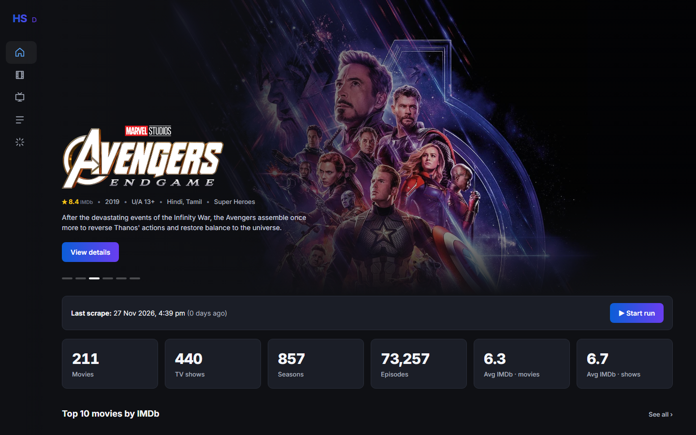
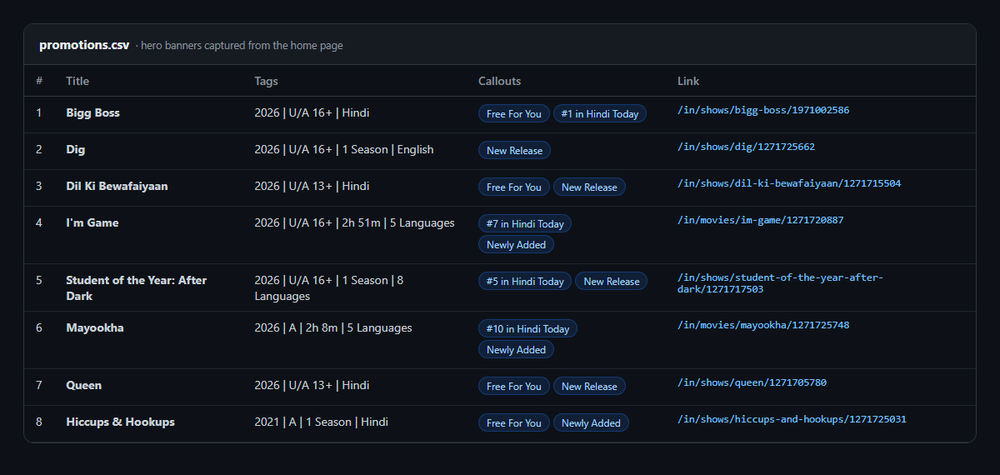
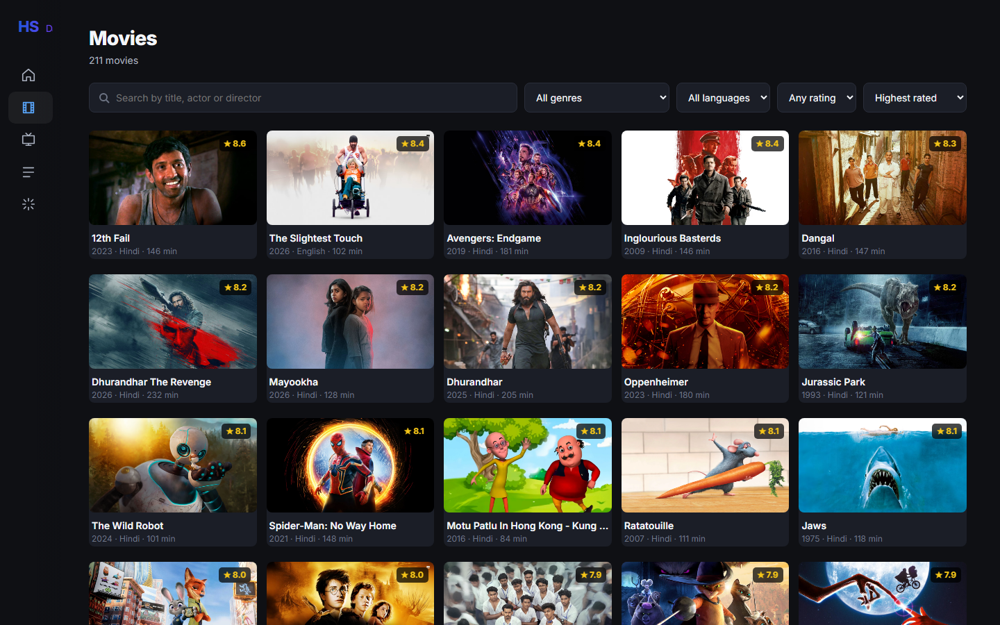
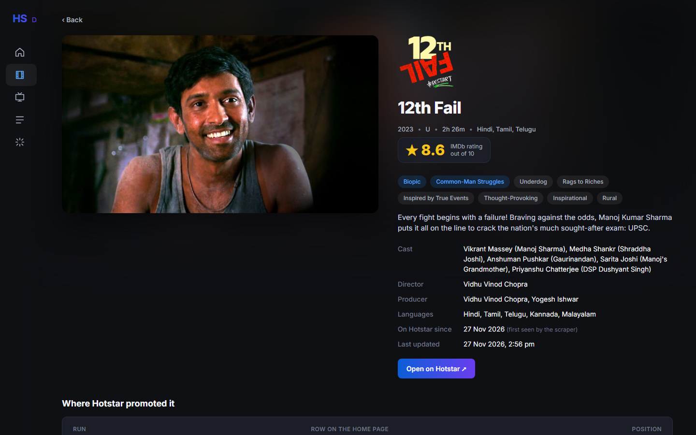
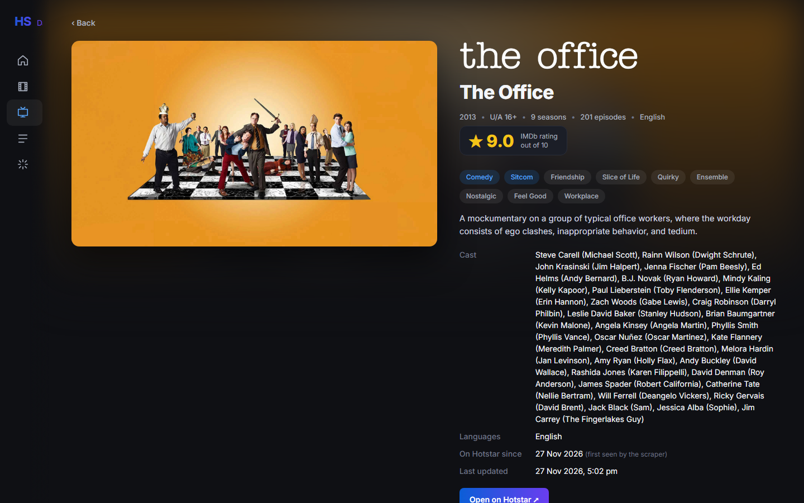
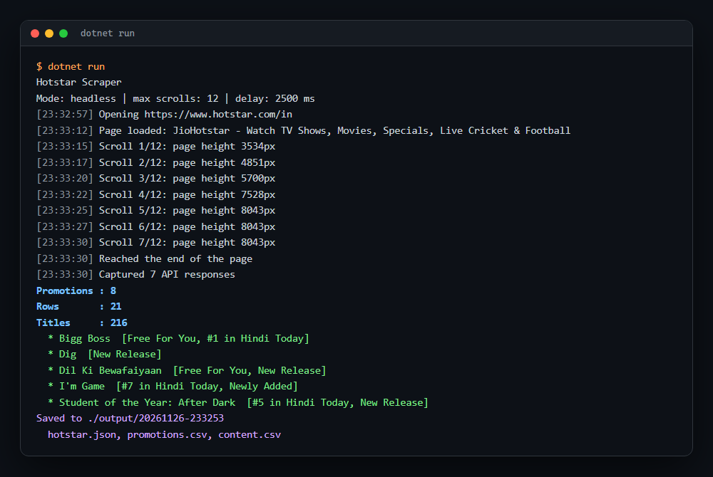

<div align="center">

# Hotstar Scraper

**A C# / .NET 8 + Playwright scraper that captures JioHotstar's home-page promotions and content rows as clean JSON and CSV.**




</div>

## What it does

One run of the scraper:

1. Opens `hotstar.com/in` in a real (headless) Chromium browser.
2. Scrolls the page like a visitor, so the rows that load as you scroll are fetched too.
3. **Captures the JSON the page itself loads** from Hotstar's API, instead of scraping HTML.
4. Extracts:
   - **Promotions:** the rotating hero banners, with title, description, tags, highlight badges ("Free For You", "#1 in Hindi Today"), link, image and content ID.
   - **Content rows:** every row on the page ("New on JioHotstar", "Top 10 in India Today", "Popular Movies"…), with each title's description, tags, link, image and content ID.
5. Exports everything to a timestamped folder as **JSON** plus **two CSVs** that open straight in Excel or Power BI.

A typical run takes about 35 seconds and returns **8 promotions, 21 rows and 200+ titles**.



## Why it intercepts the API instead of parsing HTML

Streaming sites rebuild their HTML with randomised class names, so CSS-selector scrapers break all the time. The data the page loads from its own API is structured and far more stable. The scraper listens to those responses through Playwright's `page.Response` event and parses the widgets inside them:

| Widget | Becomes |
|---|---|
| `MastheadWidget` | `Promotion` (hero banners) |
| `ScrollableTrayWidget` | `ContentTray` with `ContentItem`s |
| `CWTrayWidget` | Skipped ("Continue Watching" is personal) |

Rows use several card layouts (vertical posters, horizontal cards, episode cards, category tiles). The parser handles each of them and removes duplicate rows that pagination can return.

## Quick start

**Requirements:** .NET 8 SDK

```bash
git clone https://github.com/uttaminsights/hotstar-scraper.git
cd hotstar-scraper
dotnet build
pwsh bin/Debug/net8.0/playwright.ps1 install chromium   # one-time browser download
dotnet run
```

Results go to `output/<timestamp>/`:

| File | Contents |
|---|---|
| `hotstar.json` | Everything: promotions plus rows with their titles |
| `promotions.csv` | One row per hero banner |
| `content.csv` | One row per title, with its row name and position |

A trimmed example is in [`samples/sample-output.json`](samples/sample-output.json).

### Options

```bash
dotnet run -- --headed            # watch the browser while it scrapes
dotnet run -- --max-scrolls 20    # scroll further (default 15)
dotnet run -- --delay 4000        # wait longer between scrolls (ms, min 1000)
dotnet run -- --output data       # choose the output folder
dotnet run -- --save-raw          # also keep the raw API responses for debugging
```

### Docker

```bash
docker build -t hotstar-scraper .
docker run --rm -v "$PWD/output:/app/output" hotstar-scraper
```

The image is based on Microsoft's official `playwright/dotnet` image, so the browsers are already installed.

## Project structure

```
HotstarScraper/
├── Program.cs                      Entry point: options, run, summary, exit codes
├── Models/
│   ├── Promotion.cs                Hero banner
│   ├── ContentTray.cs              Row and its ContentItems
│   ├── ScrapeResult.cs             Output of one run
│   └── ScraperOptions.cs           Command-line options
├── Services/
│   ├── ScraperService.cs           Playwright: open, scroll, capture API responses
│   ├── HotstarResponseParser.cs    Widget JSON → models
│   └── ExportService.cs            JSON + CSV export
├── samples/sample-output.json
└── Dockerfile
```

## Scraping responsibly

- Only visits the public home page, which Hotstar's `robots.txt` allows. It skips everything robots.txt disallows (search, playback, personal pages).
- No login, no paywall or DRM bypass, and no anti-bot evasion.
- One page per run, with a pause between scrolls and a hard cap on scroll steps.
- Collects promotional metadata only (titles, descriptions, links), never video.

This is a learning and portfolio project. Respect Hotstar's terms of use, and don't run it at high frequency or redistribute the data commercially.

## Roadmap

- [x] Playwright setup and browser automation
- [x] Infinite-scroll handling
- [x] Promotion and content-row extraction through API interception
- [x] JSON and CSV export
- [x] Linux Docker image
- [ ] Database storage (SQLite/PostgreSQL) to track promotions over time
- [ ] Scheduled daily runs with change detection
- [ ] Unit tests for the parser using recorded responses

---

<div align="center">
Built by <a href="https://github.com/uttaminsights"><b>UttamInsights</b></a>
</div>

## Dashboard app (Windows)

A dark, local dashboard over the MySQL data: Overview, Movies, TV Shows (seasons and episodes), Home Page (what Hotstar promoted, row by row) and Runs.
The **Start run** button scrapes on this laptop. Hotstar India blocks servers outside India, so the scraper has to run from an Indian connection.

| Movies: search, genre, language and rating filters | Movie page: image on the left, all details on the right |
|---|---|
|  |  |
| **TV show page: seasons and episodes** | **A scraper run in the terminal** |
|  |  |

**Install (no source code needed)**
1. Download `HotstarDashboard.zip` from the latest [release](../../releases) and unzip it, for example to `C:\HotstarDashboard`.
2. Set the MySQL login once (PowerShell):
   `[Environment]::SetEnvironmentVariable("HOTSTAR_DB", "Server=localhost;Port=3306;Database=hotstar;User ID=root;Password=...;", "User")`
3. Double-click `HotstarDashboard.exe` (or make a desktop shortcut). It opens http://localhost:5080. Keep its window open while you use it.

The first run downloads Chromium for the scraper (about 150 MB, once). Run logs and reports go to `%LOCALAPPDATA%\HotstarDashboard\output`.
**Start run** updates the home page, new episodes and movies older than 7 days; **Full run** re-scrapes everything (about 3 hours). Run it about once a month.

**From source:** `dotnet run --project Dashboard`

**New release:** `git tag v1.0.1 && git push origin v1.0.1` builds the zip on GitHub (`.github/workflows/release.yml`).
